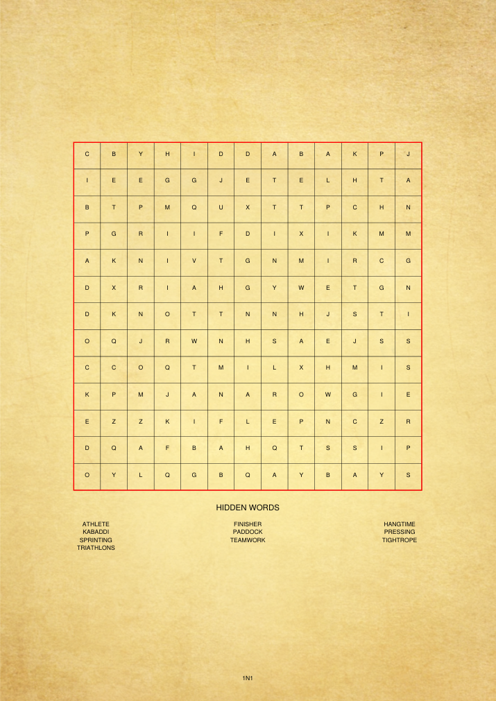
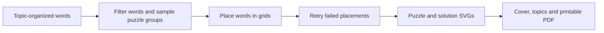

<div align="center">

# BOOP

**Book Of Organized Puzzles**

Turn a topic-organized word list into a printable word-search book, with solutions included.

[](https://github.com/Muneer320/BOOP) [](requirements.txt) [](LICENSE)

[**Current web version**](https://github.com/Muneer320/BOOP-web) · [**Run this CLI**](#generate-a-small-book) · [**Original design**](#from-word-list-to-puzzle-book)

</div>

> [!NOTE]
> **Archived original CLI.** This repository preserves the command-line project that preceded [BOOP-web](https://github.com/Muneer320/BOOP-web). Active development moved to the web version; the legacy source and its learning history remain available.

## A word list becomes something you can print

BOOP started with a simple idea: organize words by topic, generate word searches around them, then assemble the pages into a book. It handles topic transitions, different puzzle sizes, bonus pages and answer grids, so the result is a PDF rather than a folder of unrelated puzzles.

<p align="center"></p>

*A page from a freshly generated small book using the bundled topics and one Normal puzzle per topic. Placements are randomized; the CLI has no seed option.*

| Organize a theme | Generate the challenge | Produce a book |
| --- | --- | --- |
| Topic headers and word/phrase lists | Normal, Hard and bonus puzzle groups | Cover, topic pages, puzzle SVGs and solutions assembled into PDF |

## Generate a small book

Use Git and Python 3.12+; Python 3.13 is verified. The legacy PDF dependencies remain pinned in `requirements.txt`.

```sh
git clone https://github.com/Muneer320/BOOP.git
cd BOOP
python -m pip install -r requirements.txt
python main_arg.py --name SmallBook --words-file Words/words.txt --json-file output/words.json --output output/puzzles --normal 1 --hard 0 --bonus-normal 0 --bonus-hard 0
```

Open `SmallBook.pdf`. The command produces one Normal puzzle per bundled topic, plus the book structure and solutions. Intermediate JSON/SVG files are under `output/`. A book with the same name is replaced. This local generation needs no account, API key or external service.

## From word list to puzzle book



<details>
<summary><strong>Interactive mode, default counts and word requirements</strong></summary>

Python 3.12 or newer is required. From the repository root:

```bash
python -m pip install -r requirements.txt
python main.py
```

The interactive command reads `Words/words.txt`, generates `Words/words.json`, and writes `Where's Word-o.pdf` and puzzle SVGs in `generated_puzzles/`. Starting from puzzle 1 replaces an existing book with the same name. A later starting number appends to that book.

For command-line options, run `python main_arg.py --help`. For example:

```bash
python main_arg.py --name MyBook --words-file Words/words.txt --json-file output/words.json --output output/puzzles
```

`main_arg.py` replaces an existing PDF with the same name. The default counts per topic are 10 Normal, 5 Hard, 1 Bonus Normal and 1 Bonus Hard puzzle. Normal grids are 13×13; Hard grids are 17×17. Each Normal puzzle needs 10 words of 4–11 characters; each Hard puzzle needs 15 words of 6–15 characters. With the default counts, a topic needs at least 110 Normal-eligible and 90 Hard-eligible words. A word may qualify for both pools.

If a topic lacks enough words, generation stops with an error. A puzzle that cannot be placed is retried; if it still fails, the book is left incomplete and the command reports failure.

</details>

<details>
<summary><strong>Input format and intermediate-file cleanup</strong></summary>

`Words/words.txt` contains a topic line beginning with `>`, followed by one word or phrase per line. Separate topics with a line of 20 equals signs (`====================`). See the bundled input for an example.

`main_arg.py --delete` recursively removes the selected puzzle output directory. Use a dedicated generated-output directory, and do not point `--output` at source or personal files. Omit that flag to inspect the generated SVGs.

</details>

## What the archive preserves

The interactive CLI, argument-based CLI, word-placement routine and PDF layout show the project's path toward BOOP-web. The legacy renderer has limits: non-Latin-1 topic names may fail in title pages, and an unresolved placement failure leaves the book incomplete. Use the maintained web project for current development/support.

Run `python -m unittest discover -s tests -v` for the existing generation checks. A useful archive fix should include its exact input/options and a small generated PDF; for new features, start with [BOOP-web](https://github.com/Muneer320/BOOP-web).

The placement routine was adapted from Christian Hill's [Making a word search puzzle in Python](https://scipython.com/blog/making-a-word-search-puzzle-in-python/). PDF assembly, topic handling and book layout were developed for BOOP by [Muneer Alam](https://github.com/Muneer320). [MIT license](LICENSE).
